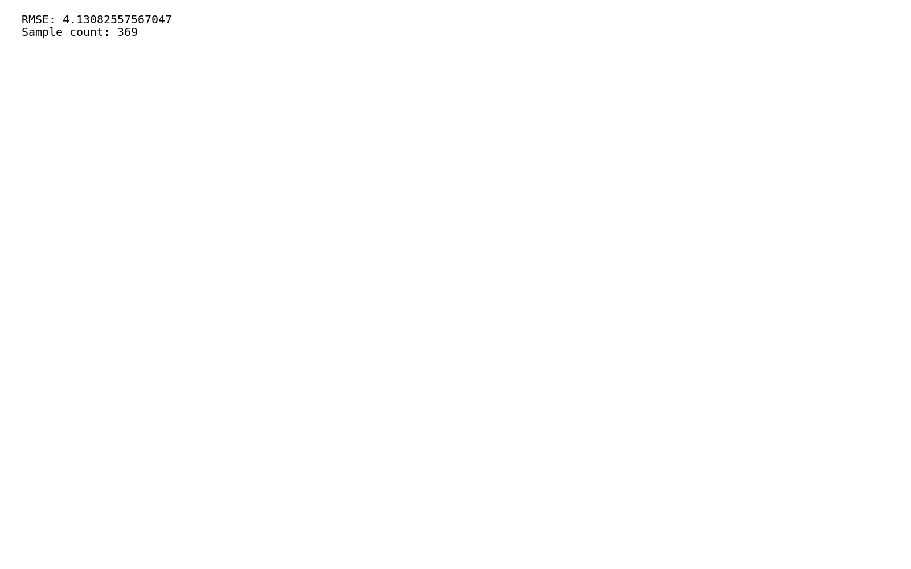
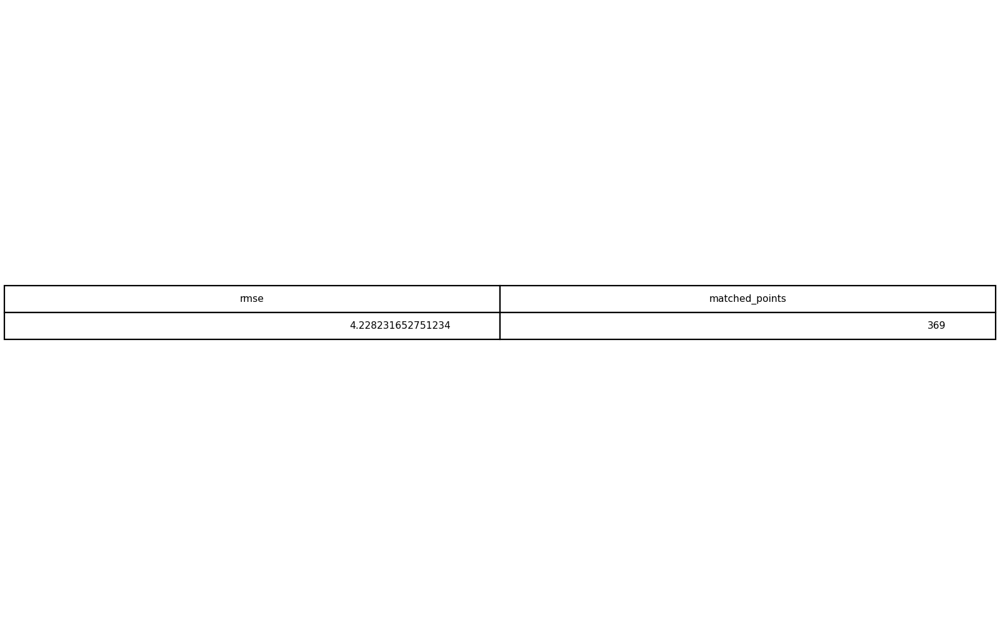

# GIS 错误证据：GeoAgent Task 104

- 主标签：D3 空间统计误判
- LLM：MiniMax-M2.7-highspeed（minimax）
- 推理配置：thinking 开关未单列记录
- 视觉审查：至少审查一项可视化成果

## 1. 任务目标

使用给定的检查点位置，提取两个DEM文件的值，然后计算RMSE。

## 2. 任务执行工作流

1. 在检查点位置分别采样两幅 DEM。
2. 剔除任一 DEM 为 NoData 的检查点。
3. 使用共同有效样本计算 RMSE。

## 3. 错误发生位置

错误出在 RMSE 有效检查点集合。任务要求在给定检查点位置提取两个 DEM 值后计算 RMSE，运行中采用的检查点集合不正确。

## 4. 错误机制与结果影响

`rmse_result.txt` 中 RMSE 不对应有效检查点集合，不能反映两个 DEM 的真实差异。

## 5. 具体错误证据

- `execution_result/workflow/step_02_code.py、execution_result/workflow/step_03_code.py、execution_result/workflow/step_04_code.py` 提取检查点 DEM 值并计算 RMSE。
- 输出 RMSE 为 4.128375/4.130826，使用共同有效检查点计算的 RMSE 为 4.228232。
- 有效检查点数量为 369，错误来自参与 RMSE 的样本集合不一致。

## 6. 任务执行结果预览

下图由错误运行写出的最终成果生成。图层或表格内容以原文件为准，错误判定依据上述处理逻辑和数值证据。

## 7. 解决错误后 GIS 任务应有的结果预览

下图来自同一任务的正确运行，展示在修正“RMSE 计算没有采用正确的有效检查点集合”后应得到的最终成果。

## 8. 可视化判读说明

本任务的预览图只能呈现成果外观。判读重点是第 5 节列出的函数调用、字段选择、输出元数据和日志参数；这些材料说明错误如何进入 CRS、transform、bounds、像元大小、NoData、字段或 Shapefile 组件。
