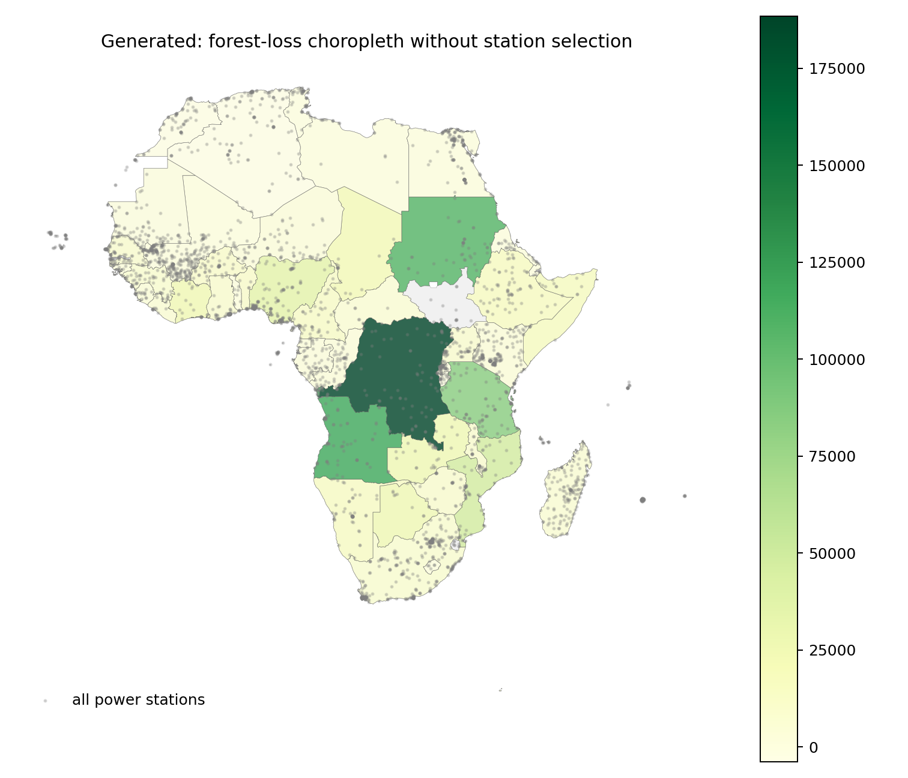
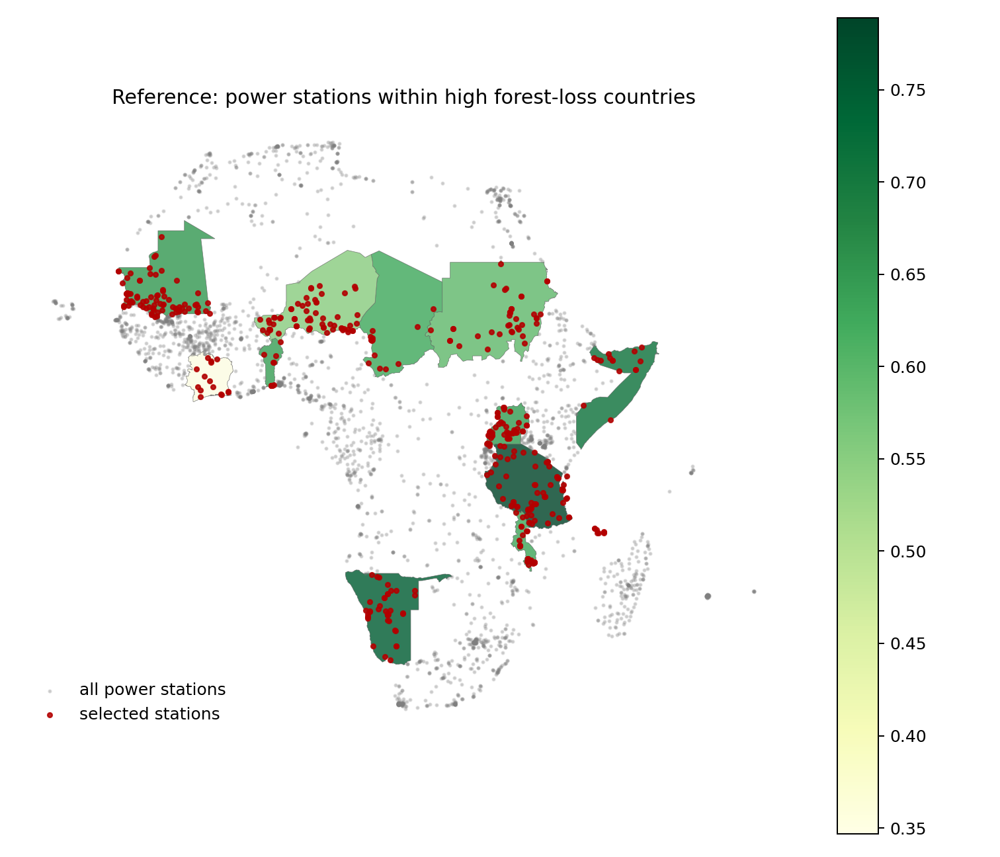

# GIS 错误证据：GeoBenchX Power Stations Forest Loss Threshold

- 主标签：D3. Spatial Statistical Misinterpretation
- 次标签：D1. Aggregation Scope Confusion
- LLM 配置：claude-3-5-haiku-20241022（GeoBenchX evaluator tuning set published trace）
- 来源项目：GeoBenchX
- 难度：hard

## 1. 任务目标

先用森林面积时间序列定义显著森林损失国家，再用国家面与非洲电站点做空间筛选，返回位于这些国家内的电站数量。

## 2. 任务执行工作流

1. 参考流程读取国家边界、森林面积表和非洲电站点。
2. 参考流程计算 `forest_change_ratio = 2021 / 1990`，用统计阈值筛选显著森林损失国家。
3. 参考流程用 `within` 空间谓词选择这些国家内的电站。
4. 错误流程计算 2000-2021 森林损失后直接制图，缺少统计阈值和空间筛选步骤。

## 3. 错误发生位置

错误发生在生成工具调用序列第 6-7 步之后：生成流程从 `calculate_columns` 直接进入 `make_choropleth_map`，缺少参考流程中的 `calculate_column_statistics`、`filter_numerical` 和 `select_features_by_spatial_relationship`。

## 4. 错误机制与结果影响

`significant forest loss` 是空间统计判定，不是任意森林损失图层；任务问题还要求统计位于这些国家内的电站数量。模型把统计阈值判定和点-面空间筛选都省略，导致最终成果从“计数问题”退化为“森林损失地图”。

## 5. 具体错误证据

```json
{
  "reference_threshold_metric": "forest_change_ratio = 2021 / 1990",
  "reference_threshold_value": 0.79,
  "computed_first_quartile": 0.7914654482710257,
  "reference_high_loss_country_count": 12,
  "reference_selected_power_station_count": 451,
  "generated_metric": "forest_loss = 2000 - 2021",
  "generated_final_tool": "make_choropleth_map",
  "generated_has_statistical_threshold_step": false,
  "generated_has_power_station_spatial_selection": false,
  "missing_reference_steps": [
    "calculate_column_statistics",
    "filter_numerical",
    "select_features_by_spatial_relationship"
  ],
  "top_reference_high_loss_countries": [
    {
      "NAME_EN": "Cote d'Ivoire",
      "1990": 78508.6,
      "2021": 27238.267,
      "forest_change_ratio": 0.34694628359186125
    },
    {
      "NAME_EN": "Niger",
      "1990": 19450.0,
      "2021": 10672.8,
      "forest_change_ratio": 0.5487300771208226
    },
    {
      "NAME_EN": "Sudan",
      "1990": 307273.1,
      "2021": 181873.9,
      "forest_change_ratio": 0.5918965897112374
    },
    {
      "NAME_EN": "Chad",
      "1990": 67300.0,
      "2021": 42013.333,
      "forest_change_ratio": 0.6242694353640416
    },
    {
      "NAME_EN": "Malawi",
      "1990": 35017.0,
      "2021": 21997.0,
      "forest_change_ratio": 0.6281805979952595
    },
    {
      "NAME_EN": "Benin",
      "1990": 48351.5,
      "2021": 30851.5,
      "forest_change_ratio": 0.6380670713421507
    },
    {
      "NAME_EN": "Uganda",
      "1990": 35754.7,
      "2021": 22966.433,
      "forest_change_ratio": 0.6423332596833424
    },
    {
      "NAME_EN": "Mauritania",
      "1990": 4760.4,
      "2021": 3073.667,
      "forest_change_ratio": 0.6456741030165533
    }
  ],
  "human_score": 0,
  "human_reasoning": "The candidate solution does not match any of the reference solutions. It loads correct datasets. However, the tools called are different. Both reference solutions contain 'select_features_by_spatial_relationship' on 'Power stations in Africa' dataset to get answer to the task. No such tool is used in the candidate solution."
}
```

## 6. 任务执行结果预览



## 7. 解决错误后 GIS 任务应有的结果预览



## 8. 可视化判读说明

本案例的核心证据是 GeoBenchX 发布的人审工具调用轨迹、生成方案与参考方案的步骤差异，以及本地数据审计重新计算出的参考指标/错误指标。预览图用于展示错误工作流与参考工作流表达的主题变量不同，最终判定以第 5 节的指标和 `execution_result/workflow/` 下的工具调用 JSON 为准。
