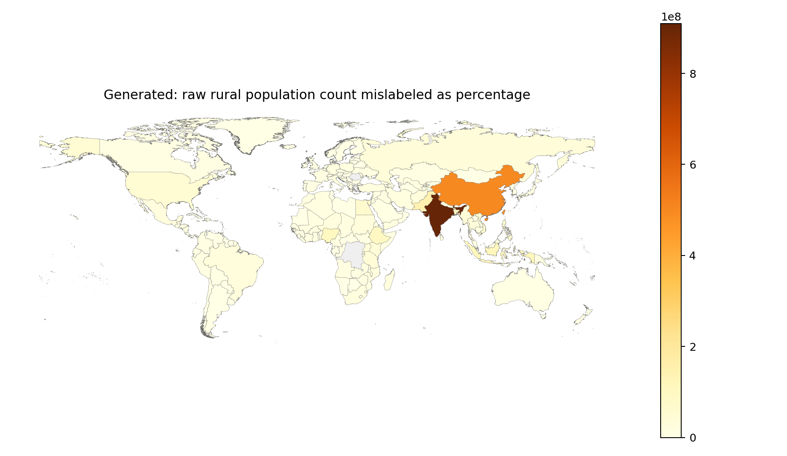
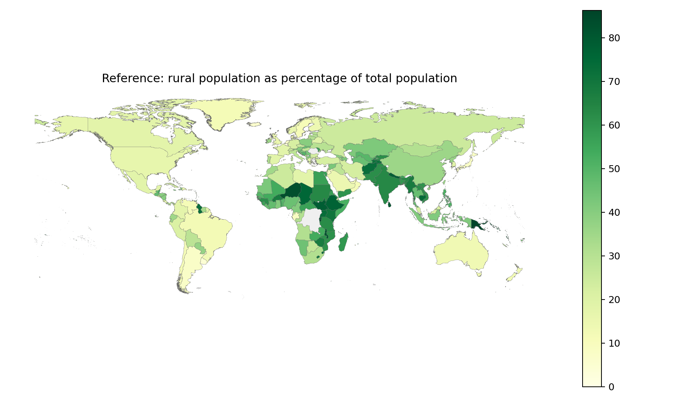

# GIS 错误证据：GeoBenchX Rural Population Percentages

- 主标签：D3. Spatial Statistical Misinterpretation
- 次标签：无
- LLM 配置：claude-3-5-haiku-20241022（GeoBenchX evaluator tuning set published trace）
- 来源项目：GeoBenchX
- 难度：medium

## 1. 任务目标

先用农村人口除以总人口并乘以 100 得到每个国家的农村人口百分比，再将该百分比连接到国家边界并制作世界分级设色图。

## 2. 任务执行工作流

1. 参考流程读取农村人口和总人口两个统计表。
2. 参考流程计算 `rural_population / total_population * 100`。
3. 错误流程只读取农村人口表并直接与国家边界合并。
4. 错误流程用 `2023` 原始人口数做 choropleth，却在图例中标注为百分比。

## 3. 错误发生位置

错误发生在生成工具调用序列的统计变量构造阶段：缺少 `Population, total` 数据、`calculate_columns` 和 `scale_column_by_value`，并在 `make_choropleth_map` 中使用 `mappingkey=2023`。

## 4. 错误机制与结果影响

这是典型的空间统计变量语义误解：百分比是强度/比例变量，不能用农村人口总量替代。错误结果会把人口大国突出显示为“百分比高”，与真实农村人口占比完全不同，同时图例误标加重误导。

## 5. 具体错误证据

```json
{
  "reference_mapping_key": "rural_percentage",
  "generated_mapping_key": "2023",
  "missing_reference_steps": [
    "calculate_columns",
    "scale_column_by_value"
  ],
  "omitted_total_population_dataset": true,
  "observed_legend_text": "Rural Population (%)",
  "raw_rural_population_2023_max": 909121500.0,
  "rural_percentage_max": 86.2770041736,
  "reference_top_rural_percentage": [
    {
      "mapped_country_name": "Papua New Guinea",
      "rural_percentage": 86.2770041736
    },
    {
      "mapped_country_name": "Liechtenstein",
      "rural_percentage": 85.38298302344381
    },
    {
      "mapped_country_name": "Burundi",
      "rural_percentage": 85.21599669571287
    },
    {
      "mapped_country_name": "Niger",
      "rural_percentage": 82.94599943101535
    },
    {
      "mapped_country_name": "Samoa",
      "rural_percentage": 82.4921016833495
    },
    {
      "mapped_country_name": "Rwanda",
      "rural_percentage": 82.10799774638421
    },
    {
      "mapped_country_name": "Malawi",
      "rural_percentage": 81.7200003955713
    },
    {
      "mapped_country_name": "Saint Lucia",
      "rural_percentage": 80.8278456152809
    }
  ],
  "generated_top_raw_rural_population": [
    {
      "mapped_country_name": "India",
      "rural_population_2023": 909121500.0
    },
    {
      "mapped_country_name": "China",
      "rural_population_2023": 499814553.0
    },
    {
      "mapped_country_name": "Pakistan",
      "rural_population_2023": 149004914.0
    },
    {
      "mapped_country_name": "Indonesia",
      "rural_population_2023": 114976836.0
    },
    {
      "mapped_country_name": "Bangladesh",
      "rural_population_2023": 102954517.0
    },
    {
      "mapped_country_name": "Nigeria",
      "rural_population_2023": 102316764.0
    },
    {
      "mapped_country_name": "Ethiopia",
      "rural_population_2023": 97227189.0
    },
    {
      "mapped_country_name": "Egypt, Arab Rep.",
      "rural_population_2023": 64135744.0
    }
  ],
  "human_score": 0,
  "human_reasoning": "The candidate solution uses less tools than the reference solution. The candidate solution does not calculate the percentage of the rural population but directly maps its total value, though the question was about the percentages. So the candidate solution is not a match to the reference solution."
}
```

## 6. 任务执行结果预览



## 7. 解决错误后 GIS 任务应有的结果预览



## 8. 可视化判读说明

本案例的核心证据是 GeoBenchX 发布的人审工具调用轨迹、生成方案与参考方案的步骤差异，以及本地数据审计重新计算出的参考指标/错误指标。预览图用于展示错误工作流与参考工作流表达的主题变量不同，最终判定以第 5 节的指标和 `execution_result/workflow/` 下的工具调用 JSON 为准。
