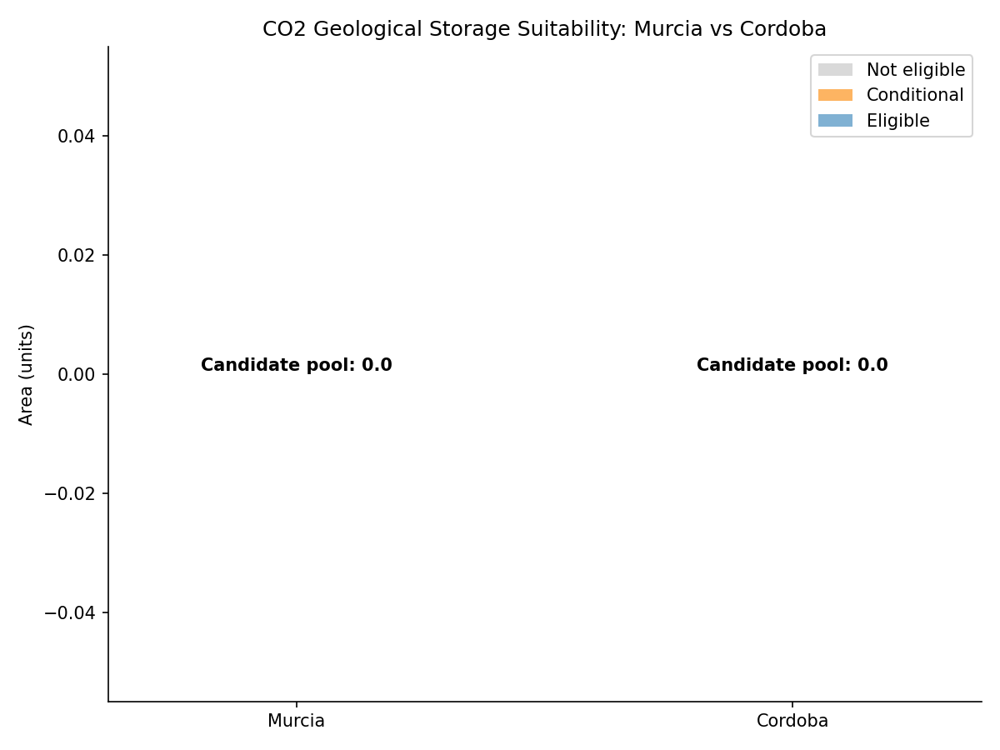
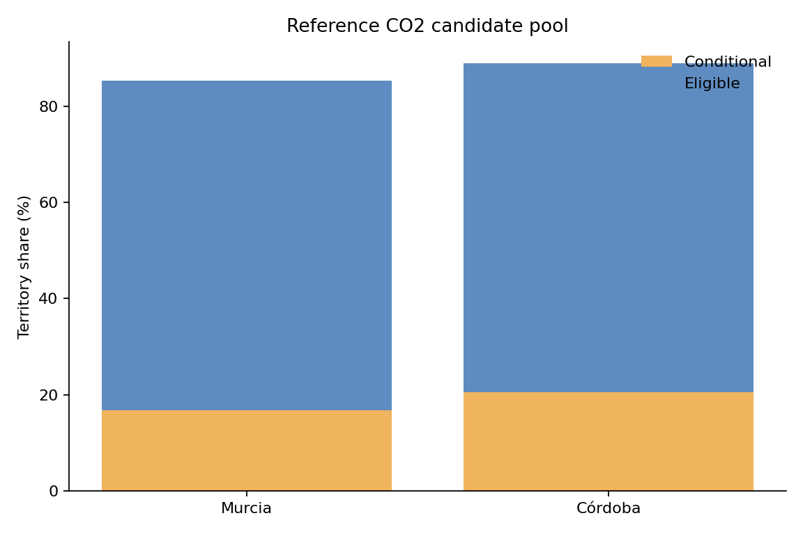

# GIS 错误证据：GeoNatureAgent CO2 Candidate Pool Comparison

- 主标签：D3. Spatial Statistical Misinterpretation
- 次标签：无
- LLM 配置：deepseek-v4-pro（DeepSeek）
- 推理配置：direct request；thinking 开关未单列记录
- 来源项目：GeoNatureAgent Benchmark
- 难度：medium

## 1. 任务目标

按 GeoNatureAgent 图层说明，用 conditional_pct + eligible_pct 构成 CO2 地质封存候选池，对 Murcia 与 Córdoba 做接近值比较。

## 2. 任务执行工作流

1. 读取 province_rankings.json 与 layers_registry.yaml。
2. 任务要求候选池为 class 1 Conditional + class 2 Eligible。
3. 生成代码只在顶层或省级字典的平铺字段中查找面积/类别值。
4. 找不到字段后返回 0，并输出零值 CSV、JSON 和堆叠柱状图。

## 3. 错误发生位置

错误发生在 `extract_province_stats()` 对 province 统计结构的解释。实际数据为 `provinces -> Murcia/Córdoba -> co2 -> *_pct`，生成代码未进入 `co2` 子对象，也没有使用任务明确给出的 candidate_pool 定义。

## 4. 错误机制与结果影响

这是空间指标统计解释错误：CO2 适宜性是省域百分比指标，比较目标不是原始面积字段，也不是单一类别，而是 conditional 与 eligible 的组合候选池。错误代码用零值代替真实指标，导致接近值比较和结论完全失真。

## 5. 具体错误证据

```json
{
  "observed_candidate_pool_values": [
    0.0,
    0.0
  ],
  "all_observed_candidate_values_zero": true,
  "expected_better_province": "Córdoba",
  "reference_decision": {
    "better_province": "Córdoba",
    "decision_metric": "candidate_pool_pct = conditional_pct + eligible_pct",
    "records": [
      {
        "province": "Murcia",
        "not_eligible_pct": 14.6,
        "conditional_pct": 16.8,
        "eligible_pct": 68.5,
        "candidate_pool_pct": 85.3
      },
      {
        "province": "Córdoba",
        "not_eligible_pct": 11.0,
        "conditional_pct": 20.6,
        "eligible_pct": 68.4,
        "candidate_pool_pct": 89.0
      }
    ]
  },
  "observed_records": [
    {
      "province": "Murcia",
      "not_eligible": 0,
      "conditional": 0,
      "eligible": 0,
      "candidate_pool": 0
    },
    {
      "province": "Cordoba",
      "not_eligible": 0,
      "conditional": 0,
      "eligible": 0,
      "candidate_pool": 0
    }
  ]
}
```

## 6. 任务执行结果预览



## 7. 解决错误后 GIS 任务应有的结果预览



## 8. 可视化判读说明

本案例的关键证据是生成代码、运行日志、错误输出表和参考结果之间的差异。图片只作为空间分析或分类统计结果的可视化辅助，最终判定以第 5 节列出的数值与代码证据为准。
