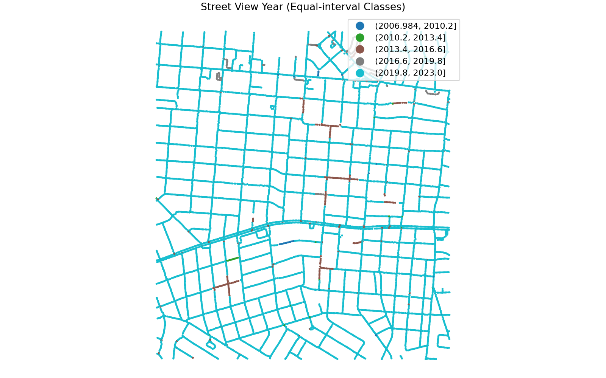
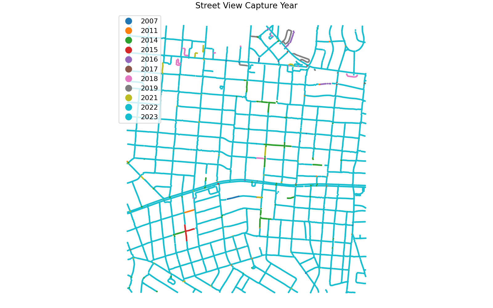

# GIS 错误证据：GeoAgent Task 79

- 主标签：E1 分类方案误用
- LLM 配置：qwen3.6-plus（dashscope）
- 推理配置：thinking 开关未单列记录
- 视觉审查：审查全部可视化成果

## 1. 任务目标

从街景点的 `image_date` 字段提取年份，使用不同颜色表示每个年份，并制作街景采集年份专题地图。

## 2. 任务执行工作流

1. 从 `image_date` 提取离散年份。
2. 错误地把年份作为连续变量划分为 5 个等距区间。
3. 按区间设色并输出专题地图。

## 3. 错误发生位置

错误出在年份分类字段生成。`execution_result/workflow/code.py` 使用等距连续分级把离散年份压成少数区间，而不是为每个采集年份建立独立类别。

## 4. 错误机制与结果影响

任务要求用不同颜色表达每一个街景采集年份；`year_equal_interval.geojson` 让多个年份共享同一分类值和颜色，读者无法从专题图判断各年份点的独立空间分布。

## 5. 具体错误证据

- 输入数据包含 11 个离散年份，而 `pd.cut(year, bins=5)` 只生成 5 个类别。
- 任务要求每个年份使用不同颜色；等距分级把多个年份合并为同一符号类别。
- 参考图把年份作为名义类别逐年设色，图例与数据中的年份一一对应。

## 6. 任务执行结果预览

下图为该处理流程得到的最终成果。非制图任务不在图内添加解释文字。

## 7. 解决错误后 GIS 任务应有的结果预览

参考图使用相同输入并修正上述 GIS 处理规则，只展示任务应得到的成果。

## 8. 可视化判读说明

制图类样本可以从预览图观察部分问题。判读重点是第 5 节列出的分类字段、配色表、图例、绘制顺序和输出设置。
