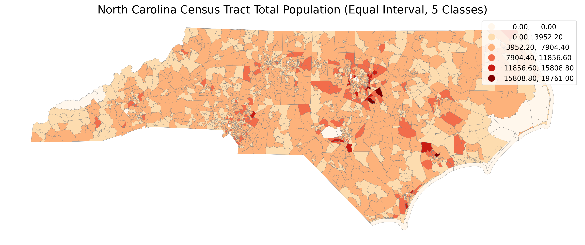
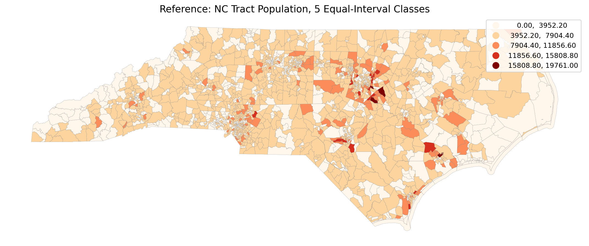

# GIS 错误证据：LLM-Geo Population_equal_interval_NC

- 主标签：E1 分类方案误用
- LLM 配置：deepseek-v4-pro（DeepSeek）
- 推理配置：direct request；thinking 开关未单列记录
- 来源项目：LLM-Geo

## 1. 任务目标

将 North Carolina Census tract 人口属性连接到 tract polygon，并制作 `TotalPopulation` 专题图。任务明确要求使用正好 5 个等距分级，不能使用 quantiles 或 natural breaks。

## 2. 任务执行工作流

1. 读取 NC tract 边界和人口 CSV。
2. 以 `GEOID` 连接属性，得到 2195 个 tract。
3. 使用 `np.linspace(min, max, 6)` 计算 6 个边界值。
4. CSV 统计使用 `pd.cut(..., bins=bins)`，得到 5 个区间。
5. 地图绘制使用 `scheme='UserDefined'` 且 `classification_kwds={'bins': bins}`。

## 3. 错误发生位置

错误发生在地图分类参数。`mapclassify.UserDefined` 把传入的 `bins` 解释为每一类的上界；代码传入 6 个边界值，因此地图分类器实际生成 6 个类别，而不是任务要求的 5 个等距类别。

## 4. 错误机制与结果影响

这属于分类方案误用：表格统计和地图表达不一致。CSV 输出显示 5 类，但最终专题图使用的分类器是 6 类，第一类只覆盖人口值为 0 的 tract，后续类别整体偏移。读者从地图图例和颜色判断时，会得到与任务指定分类方案不一致的空间分布。

## 5. 具体错误证据

- 正确 5 类等距边界为 0.0、3952.2、7904.4、11856.6、15808.8、19761.0。
- 正确 5 类 tract 数量为 876、1157、139、19、4。
- 代码传给 `UserDefined` 的 6 个上界产生 6 类，数量为 25、851、1157、139、19、4。
- `execution_result/artifacts/nc_population_equal_interval_class_counts.csv` 是 5 类，但 `execution_result/previews/nc_population_equal_interval_map.png` 的地图分类逻辑是 6 类。

## 6. 任务执行结果预览

## 7. 解决错误后 GIS 任务应有的结果预览

参考图使用 `UserDefined` 时只传入 5 个上界 `edges[1:]`，即正好 5 个等距分级。

