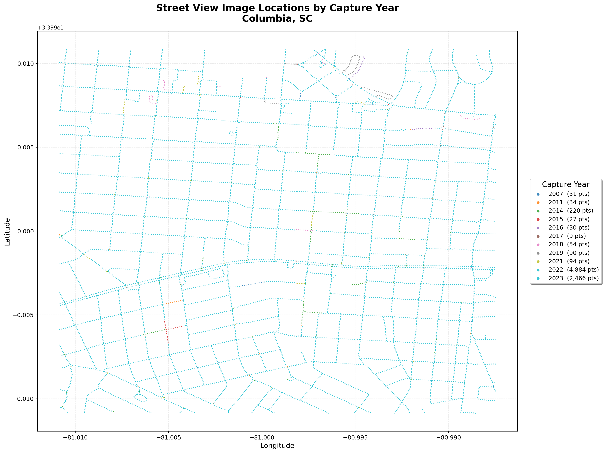

# GIS 错误证据：GeoAgent Task 79

- 主标签：E2 符号化错误
- LLM：DeepSeek V4 Pro（DeepSeek thinking 开启）
- 视觉审查：Qwen3-VL（thinking 关闭）

## 1. 任务目标

从街景点的 `image_date` 提取年份，以不同颜色渲染年份并生成专题地图。

## 2. 任务执行工作流

1. 读取街景点并解析拍摄年份。
2. 为年份类别分配颜色。
3. 绘制点图层、图例和专题地图。

## 3. 错误发生位置

错误发生在年份符号化和绘制顺序阶段：多个年份使用重复或过于接近的颜色，高频类别又覆盖低频类别。

## 4. 错误机制与结果影响

实际专题图对多个年份类别使用重复或过于接近的颜色，且高频点严重遮盖低频类别，削弱了年份辨识度。

读者难以通过图例区分相邻年份，稀疏年份点位在密集点层中被遮挡，年份空间分布无法清晰判读。

## 5. 具体错误证据

- `thematic_map.py` 为 11 个年份类别分配的颜色不能保持充分区分。
- 实际成图中相邻年份出现近似青色，图例与点位难以快速对应。
- 按年份使用不重复的有序色带并调整绘制顺序后，类别辨识度明显改善。

## 6. 任务执行结果预览

下图是 LLM 生成的年份专题地图。图中的标题和图例属于任务要求的一部分；需要重点观察不同年份的颜色是否易于区分，以及密集点是否遮挡了数量较少的年份类别。

### 最终制图成果：street_view_years_thematic_map.png

- 源成果文件：`coder/subtask_1/street_view_years_thematic_map.png`
- 说明：LLM 生成的年份专题地图原图，保留其标题、图例和年份配色。

## 7. 解决错误后 GIS 任务应有的结果预览

参考图使用不重复的有序色带，并先绘制高频年份、后绘制稀疏年份，以提高类别辨识度。

## 8. 可视化判读说明

制图错误可以从图面观察到一部分表现，错误来源主要对应代码中的分类字段、配色表、图例、绘制顺序和输出设置。
