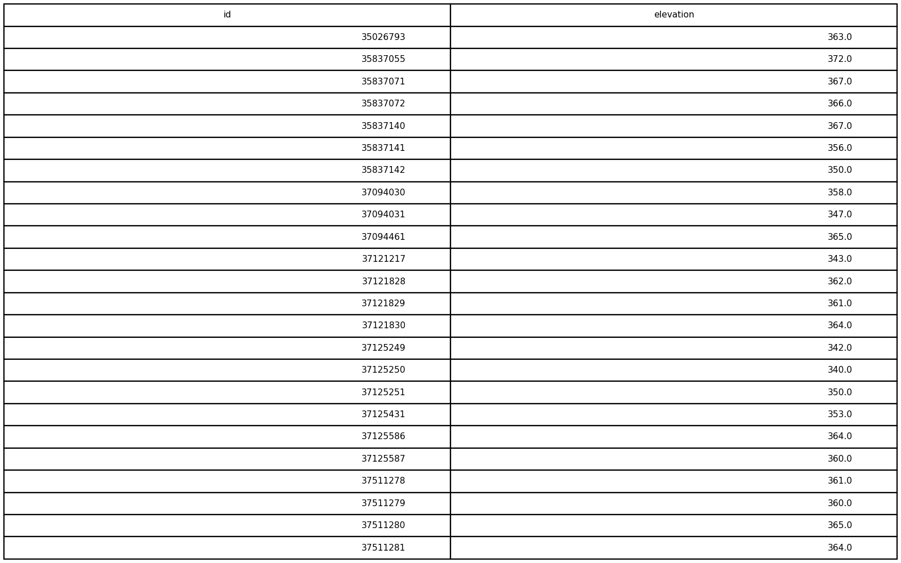
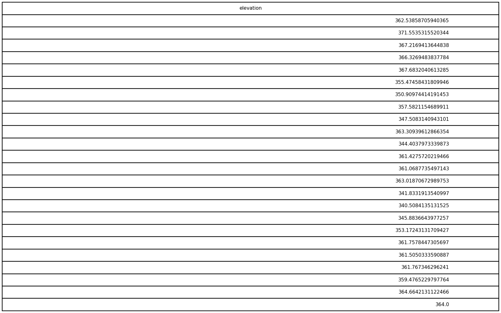

# GIS 错误证据：GeoAgent Task 78

- 主标签：E3 地图构成缺陷
- LLM：qwen3.6-plus（dashscope）
- 推理配置：thinking 开关未单列记录
- 视觉审查：未启用视觉审查

## 1. 任务目标

为每个建筑物要素生成质心并保存为Shapefile，从DEM中提取每个建筑物质心处的高程值，并将高程数据导出以使用Seaborn绘制50个分箱的直方图。

## 2. 任务执行工作流

1. 为建筑面生成质心点。
2. 从 DEM 提取各质心的高程。
3. 导出高程数据并绘制 50 个分箱的直方图。

## 3. 错误发生位置

错误出在最终制图交付阶段。工作流导出了高程数据，但没有生成任务要求的 50 分箱直方图。

## 4. 错误机制与结果影响

`building_elevations.csv` 只是中间数据，不能替代任务明确要求的 Seaborn 直方图成果。

## 5. 具体错误证据

- `execution_result/workflow/step_01_code.py、execution_result/workflow/step_02_code.py、execution_result/workflow/step_03_code.py` 生成建筑质心并提取高程。
- 输出目录中的最终交付物是 `building_elevations.csv`，没有 50 分箱 Seaborn 直方图图片。
- 任务要求的图表成果没有由代码写出。

## 6. 任务执行结果预览

下图由错误运行写出的最终成果生成。图层或表格内容以原文件为准，错误判定依据上述处理逻辑和数值证据。

## 7. 解决错误后 GIS 任务应有的结果预览

下图来自同一任务的正确运行，展示在修正“工作流没有交付任务要求的高程直方图”后应得到的最终成果。

## 8. 可视化判读说明

制图类样本可以从预览图观察部分问题。判读重点是第 5 节列出的分类字段、配色表、图例、绘制顺序和输出设置。
