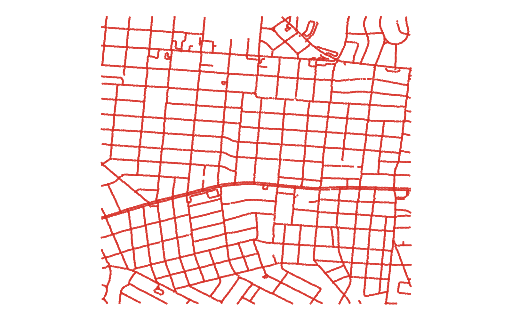
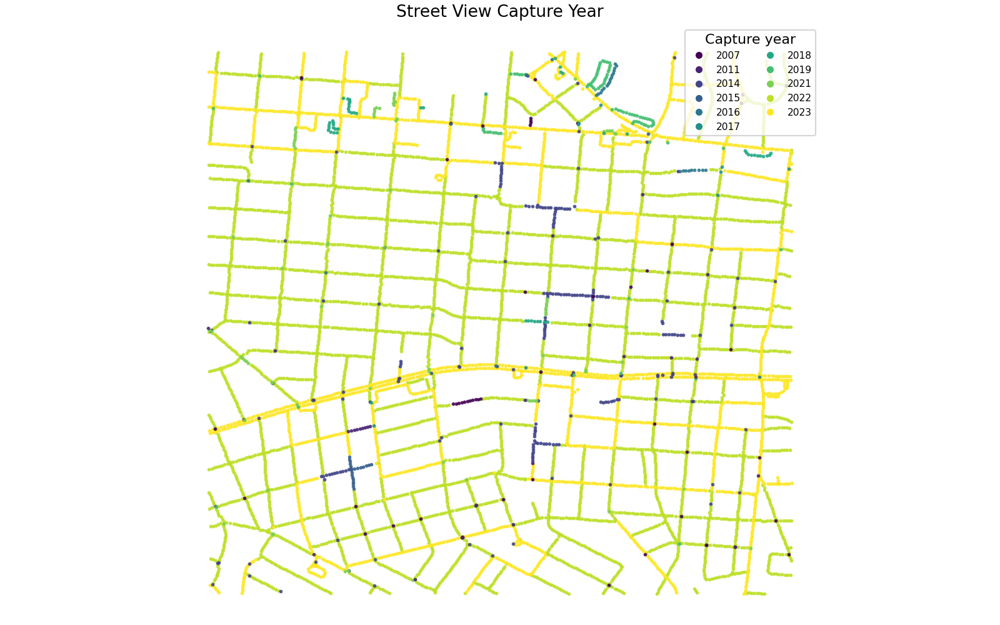

# GIS 错误证据：GeoAgent Task 79

- 主标签：E3 地图构成缺陷
- LLM：qwen3.6-plus（dashscope）
- 推理配置：thinking 开关未单列记录
- 视觉审查：审查全部可视化成果

## 1. 任务目标

从街景点的 `image_date` 提取年份，以不同颜色渲染年份并创建专题地图。

## 2. 任务执行工作流

1. 读取街景点并提取年份。
2. 把年份字段写入 `street_image_year.geojson`。
3. 结束任务，没有生成地图图片或 HTML。

## 3. 错误发生位置

问题发生在最终制图交付阶段。年份属性处理完成后，工作流没有执行按年份设色、图例组织和专题地图输出。

## 4. 错误机制与结果影响

输出只有带年份字段的矢量数据，缺少任务明确要求的专题地图。读者无法直接查看年份类别的空间分布和颜色对应关系。

## 5. 具体错误证据

- `street_image_year.geojson` 含 7959 个点和年份字段。
- 执行目录中没有 PNG、JPG 或 HTML 专题地图交付物。
- 输出材料显示未完成核心制图目标。

## 6. 任务执行结果预览

下图只是 LLM 输出 GeoJSON 的点位预览。所有点使用同一视觉样式，正好反映了年份专题符号化和地图交付物的缺失。

### 最终成果：street_image_year.geojson

- 源成果文件：`steps/step_01/street_image_year.geojson`

## 7. 解决错误后 GIS 任务应有的结果预览

参考图按年份使用可区分颜色，并提供标题和图例，展示任务要求的街景年份专题地图。

## 8. 可视化判读说明

制图类样本可以从预览图观察部分问题。判读重点是第 5 节列出的分类字段、配色表、图例、绘制顺序和输出设置。
