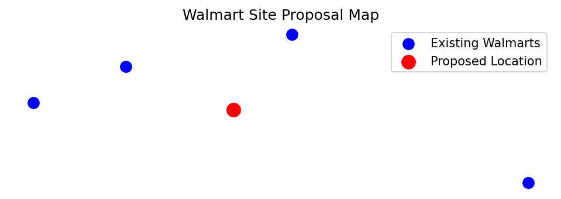
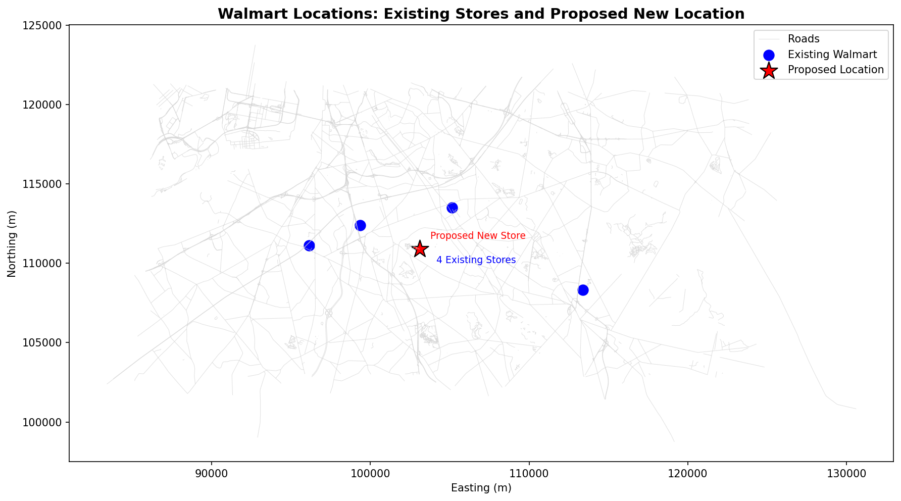

# GIS 错误证据：GeoAgent Task 102

- 主标签：E3 地图构成缺陷
- LLM：qwen3.6-plus（dashscope）
- 推理配置：thinking 开关未单列记录
- 视觉审查：未启用视觉审查

## 1. 任务目标

提出一个新的沃尔玛门店位置，该位置与现有的四个位置距离相似，同时距离道路在300米以内。将建议的位置保存为新的Shapefile，之后在新地图上绘制此新位置和旧位置，并保存为图片。

## 2. 任务执行工作流

1. 根据四个现有 Walmart 的位置确定候选中心。
2. 结合道路 300 米缓冲约束选择拟建点。
3. 绘制现有门店和拟建点位置图。

## 3. 错误发生位置

错误出在最终地图交付阶段。任务不仅要求 Shapefile，还要求在新地图上绘制新旧位置并保存图片。

## 4. 错误机制与结果影响

`walmart_proposal_map.png` 对应的地图交付缺失或不符合任务要求，空间数据本身不能替代最终地图。

## 5. 具体错误证据

- `execution_result/workflow/step_01_code.py、execution_result/workflow/step_02_code.py、execution_result/workflow/step_03_code.py、execution_result/workflow/step_04_code.py` 生成拟建点空间数据。
- 输出目录没有写出包含新旧 Walmart 位置关系的地图图片。
- 任务要求的制图交付物缺失，Shapefile 不能替代地图输出。

## 6. 任务执行结果预览

下图由错误运行写出的最终成果生成。图层或表格内容以原文件为准，错误判定依据上述处理逻辑和数值证据。

## 7. 解决错误后 GIS 任务应有的结果预览

下图来自同一任务的正确运行，展示在修正“生成了空间数据但没有交付任务要求的地图”后应得到的最终成果。

## 8. 可视化判读说明

制图类样本可以从预览图观察部分问题。判读重点是第 5 节列出的分类字段、配色表、图例、绘制顺序和输出设置。
