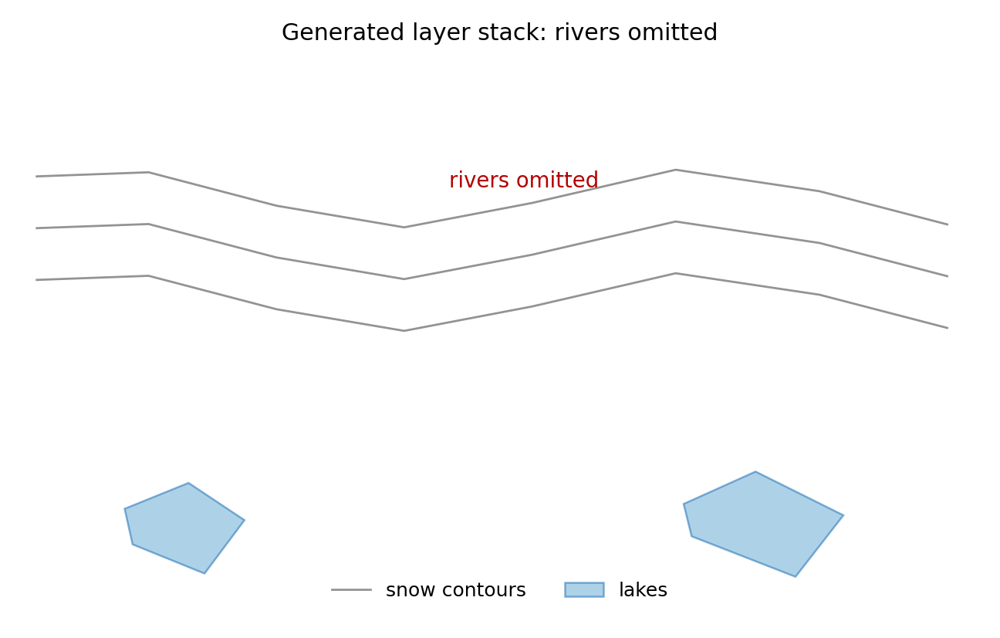
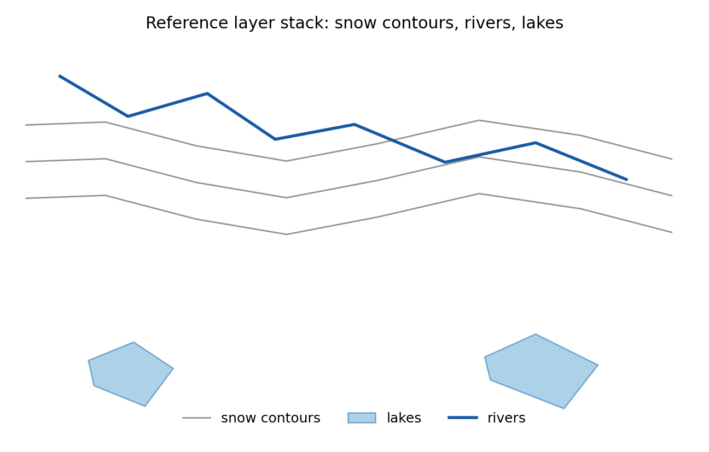

# GIS 错误证据：GeoBenchX Snow Water Bodies Layer Omission

- 主标签：E3. Map Composition Defect
- 次标签：无
- LLM 配置：claude-3-5-haiku-20241022（GeoBenchX evaluator tuning set published trace）
- 来源项目：GeoBenchX
- 难度：medium

## 1. 任务目标

从 2024-2025 USA snow accumulation raster 生成雪深等值线，并与北美主要水体图层共同制图；参考流程要求同时呈现 rivers 与 lakes。

## 2. 任务执行工作流

1. 参考流程读取雪深栅格并生成 snow contours。
2. 参考流程加载 Lakes in North America 与 Rivers in North America。
3. 参考流程在同一地图中绘制 snow_contours、rivers、lakes。
4. 生成流程只加载 lakes，并在 `visualize_geographies` 中只传入 snow_contours 与 lakes。

## 3. 错误发生位置

错误发生在 GeoBenchX 生成工具调用序列的图层准备和制图阶段：缺少 `load_geodata(geodataset='Rivers in North America')`，且 `visualize_geographies.geodataframe_names` 中没有 `rivers`。

## 4. 错误机制与结果影响

这是地图构成缺陷中的必要图层遗漏。任务文本的 major water bodies 覆盖河流和湖泊，参考流程也明确将两者作为上下文图层；生成结果只展示湖泊，会让读者误以为雪深等值线只需与湖泊关系进行判读，遗漏河流廊道这一关键空间参照。

## 5. 具体错误证据

```json
{
  "reference_required_geodata_layers": [
    "Lakes in North America",
    "Rivers in North America"
  ],
  "generated_loaded_geodata_layers": [
    "Lakes in North America"
  ],
  "missing_required_geodata_layers": [
    "Rivers in North America"
  ],
  "reference_visual_layers": [
    "snow_contours",
    "rivers",
    "lakes"
  ],
  "generated_visual_layers": [
    "snow_contours",
    "lakes"
  ],
  "missing_visual_layers": [
    "rivers"
  ],
  "reference_contour_interval": 5,
  "generated_contour_interval": 10,
  "human_score": 0,
  "human_reasoning": "The candidate solution does not match the reference solution, because, it loads only 2 of the 3 datasets that are needed. Rivers dataset is missing from the candidate solution."
}
```

## 6. 任务执行结果预览



## 7. 解决错误后 GIS 任务应有的结果预览



## 8. 可视化判读说明

本案例的核心证据是 GeoBenchX 发布的人审工具调用轨迹、生成方案与参考方案的步骤差异，以及本地数据审计重新计算出的参考指标/错误指标。预览图用于展示错误工作流与参考工作流表达的主题变量不同，最终判定以第 5 节的指标和 `execution_result/workflow/` 下的工具调用 JSON 为准。
