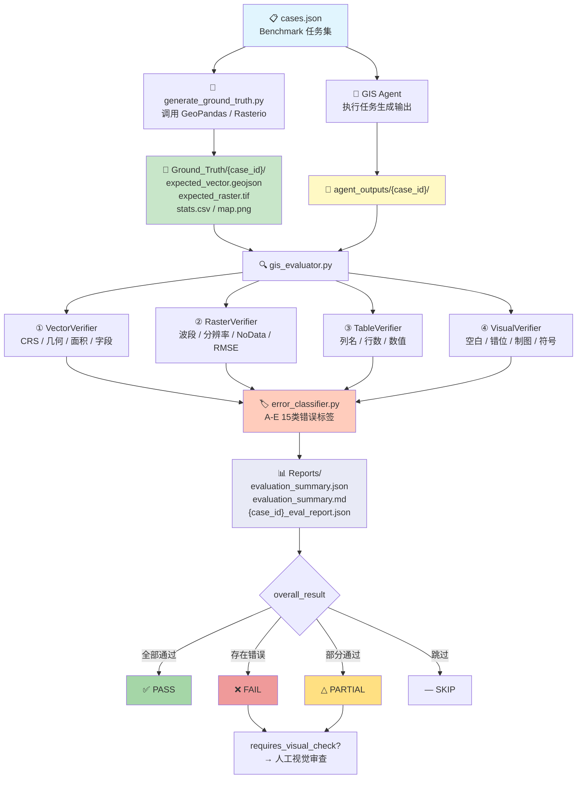
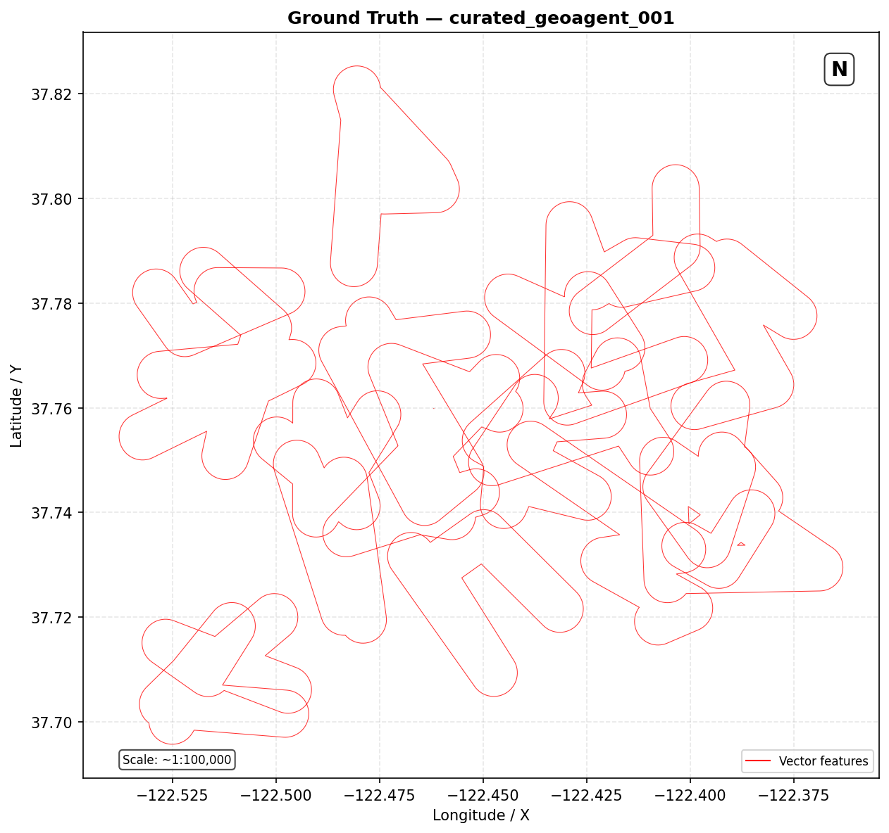
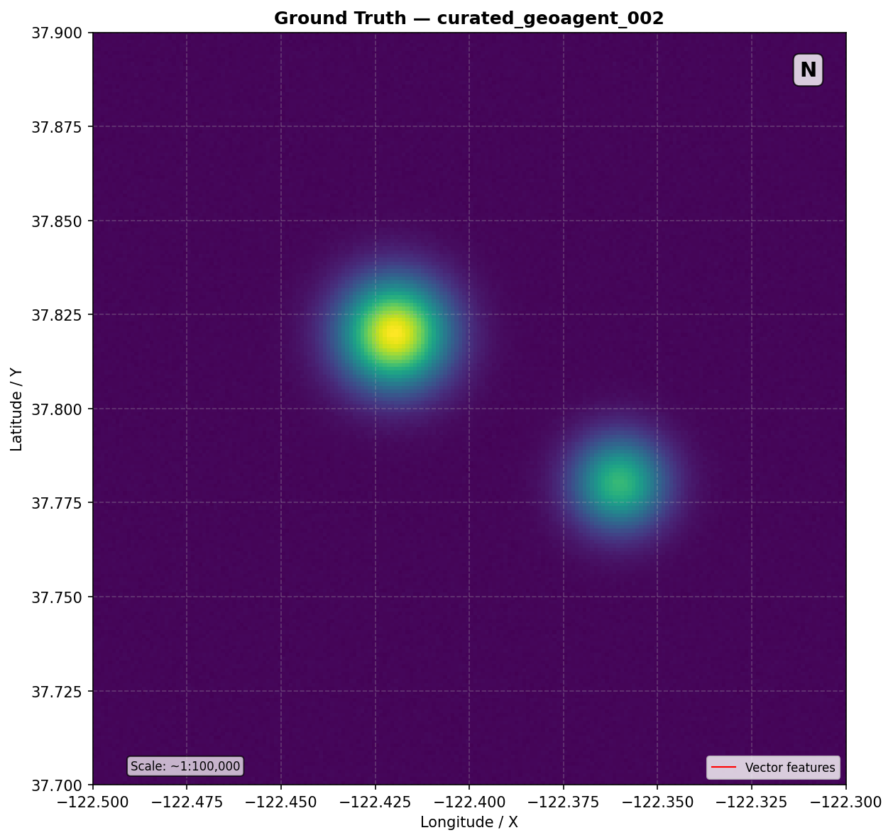
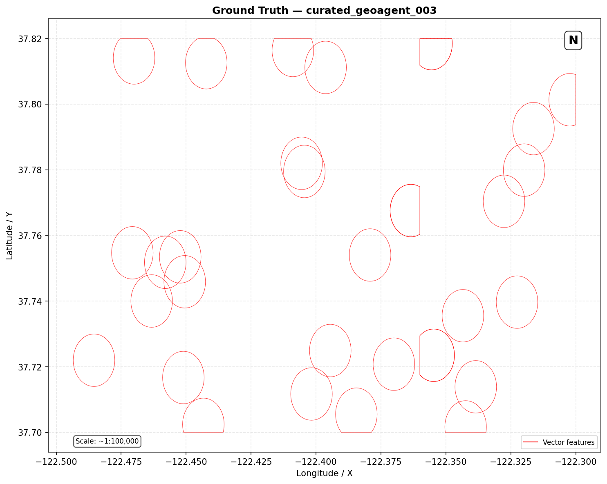
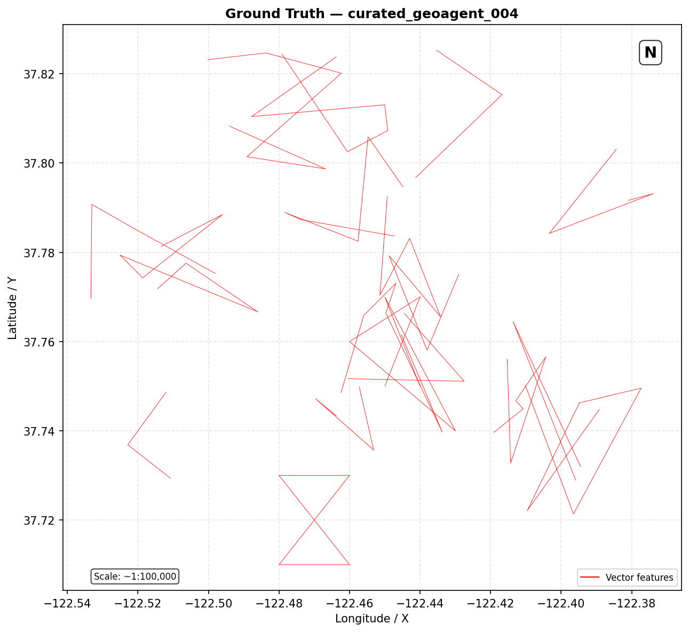
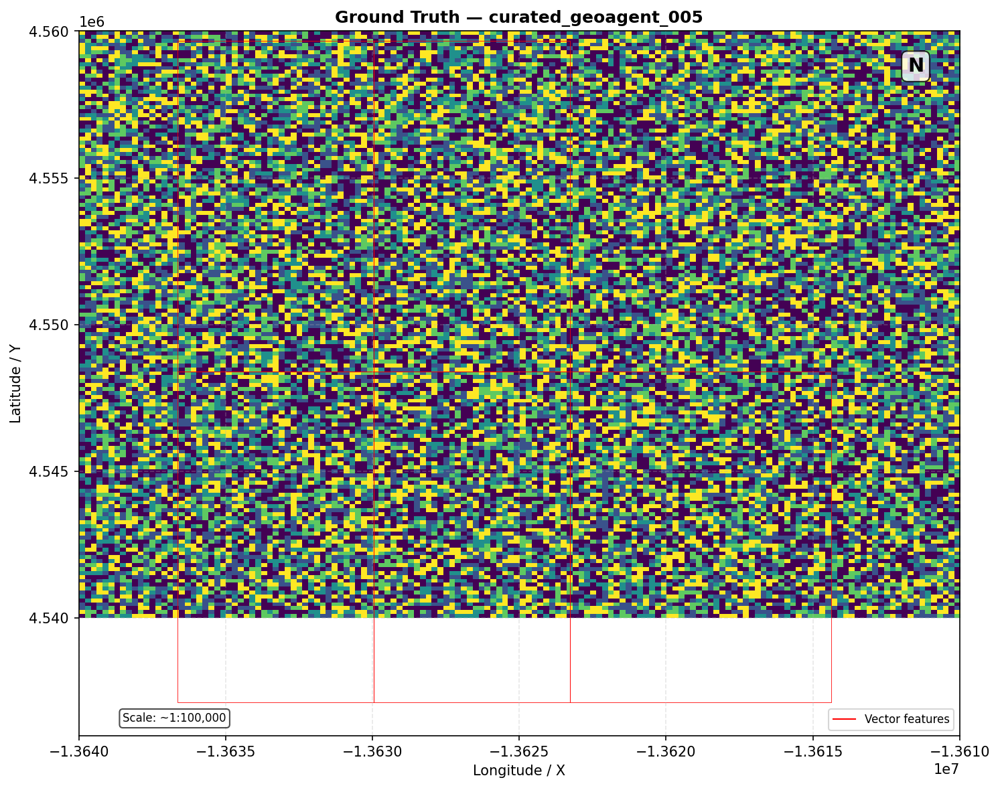

# Curated GeoAgent Dataset — GIS Error-aware Agent 基准测试框架

基于 GIS Error-aware Agent 研究工作计划，完成 **Benchmark 基准测试集构建（任务二）** 与 **自动化核验模块 Evaluation Pipeline（任务三）** 的全流程开发。

> 对应原始数据集 `curated_geoagent_dataset`，内含 140 条人工审核筛选后的 GIS 智能体任务。
> 评测目录 `evaluation/` 下的 GT 真值与核验代码对应任务三，与 `GIS_Error_Dataset_v1.json` 错误案例库相互独立。

---

## 目录结构

```
curated_geoagent_dataset/
│
├── README.md                            # 本文件 — 项目总结文档
├── cases.json                           # Benchmark 任务集 (≡ Benchmark_Tasks.json)
├── provenance.json                      # 全量数据溯源信息
│
├── assets/                              # 原始输入空间数据
│   ├── roads.shp                        #   道路网络 (20 features)
│   ├── dem.tif                          #   双峰地形 DEM (200×200)
│   ├── census_blocks.shp                #   普查区块 (30 features)
│   ├── admin_boundaries.shp             #   行政区划 (3 features)
│   └── landcover_epsg3857.tif           #   土地覆盖栅格 CRS=EPSG:3857
│
├── asset_fixes/                         # 陷阱任务扰动/修复数据
│   ├── roads_with_invalid_geom.shp      #   含自相交无效几何 (17 features, 1 invalid)
│   └── landuse_epsg4326.shp             #   土地利用矢量 CRS=EPSG:4326 (故意不匹配)
│
├── agent_outputs/                       # 模拟智能体输出 (用于先导测试)
│   ├── curated_geoagent_001/            #   ✓ 正确输出
│   ├── curated_geoagent_002/            #   ✓ 正确输出
│   ├── curated_geoagent_003/            #   △ 缺少 population 字段
│   ├── curated_geoagent_004/            #   △ 含无效几何未修复
│   └── curated_geoagent_005/            #   △ CRS 不匹配 + 范围偏移
│
├── review/                              # 人工审核定稿任务总表
│
├── generate_sample_data.py              # 合成样本数据生成脚本
├── generate_agent_outputs.py            # 模拟 Agent 输出生成脚本
│
└── evaluation/                          # ★ 评测模块 (禁止作为 Agent 任务输入)
    ├── README.md                        #   评测模块详细文档
    ├── __init__.py                      #   Python 包入口
    ├── gis_evaluator.py                 #   核心核验引擎 (矢量/栅格/表格/可视化四层)
    ├── error_classifier.py              #   错误分类器 (A-E 五大类 15 子类)
    ├── generate_ground_truth.py         #   GT 批量生成脚本
    ├── batch_evaluate.py                #   批量评测运行器
    ├── eval_curated_geoagent.py         #   ★ 主入口 (对应 README 运行命令)
    │
    ├── Schemas/
    │   ├── evaluation_schema.json       #   评估报告 JSON Schema
    │   └── cases_schema.json            #   任务配置 JSON Schema
    │
    ├── Ground_Truth/                    #   标准真值库
    │   ├── generation_manifest.json     #   生成清单
    │   ├── curated_geoagent_001/        #   单任务 GT
    │   │   ├── expected_vector.geojson  #     矢量标准结果
    │   │   ├── expected_raster.tif      #     栅格标准结果
    │   │   ├── stats.csv                #     统计真值表
    │   │   ├── map.png                  #     标准制图结果
    │   │   ├── thresholds.json          #     量化验证阈值
    │   │   └── meta.json                #     任务元信息
    │   └── ...                          #   (共 5 条已生成)
    │
    └── Reports/                         #   评测报告输出
        ├── evaluation_summary.json      #   JSON 汇总报告
        ├── evaluation_summary.md        #   Markdown 汇总报告
        └── {case_id}_eval_report.json   #   逐任务详细报告
```

---

## 快速开始

### 1. 环境准备

```powershell
# 本项目使用 conda base 环境
# 确认 Python 路径:
F:/miniconda/python.exe --version

# 安装依赖 (如未安装):
F:/miniconda/python.exe -m pip install geopandas rasterio shapely pandas numpy matplotlib pillow

# 修复 PROJ 数据库冲突 (如有 PostgreSQL 安装):
$env:PROJ_LIB = "C:\Users\print_li\AppData\Roaming\Python\Python39\site-packages\rasterio\proj_data"
```

### 2. 生成合成测试数据

```powershell
cd f:\short\curated_geoagent_dataset
F:/miniconda/python.exe generate_sample_data.py
```

为 5 条模板任务创建可用的 GIS 测试数据：道路网络、DEM 栅格、普查区块、行政区划、陷阱数据(无效几何 + CRS 冲突)。

### 3. 生成 Ground Truth 标准真值库

```powershell
# 先导测试 (前 5 条)
F:/miniconda/python.exe -m evaluation.generate_ground_truth --limit 5

# 全量生成
F:/miniconda/python.exe -m evaluation.generate_ground_truth

# 跳过已有 GT
F:/miniconda/python.exe -m evaluation.generate_ground_truth --skip-existing
```

### 4. 生成模拟 Agent 输出

```powershell
F:/miniconda/python.exe generate_agent_outputs.py
```

创建 2 个正确输出 + 3 个含错误输出，用于验证评测流水线。

### 5. 运行基准评测

```powershell
# Pilot Test 先导测试
F:/miniconda/python.exe -m evaluation.eval_curated_geoagent --limit 5 --verbose

# 完整运行
F:/miniconda/python.exe -m evaluation.eval_curated_geoagent

# 指定 Agent 输出目录
F:/miniconda/python.exe -m evaluation.eval_curated_geoagent --agent-output path/to/outputs

# 仅矢量 + 栅格核验
F:/miniconda/python.exe -m evaluation.eval_curated_geoagent --output-types vector raster

# 查看错误分类体系
F:/miniconda/python.exe -m evaluation.eval_curated_geoagent --show-taxonomy
```

---

## 评测流水线架构



### 标准评估报告文件

评测完成后在 `evaluation/Reports/` 下生成三类报告：

| 文件                           | 内容                                                     |
| ------------------------------ | -------------------------------------------------------- |
| `{case_id}_eval_report.json` | 单任务完整评测报告（四层核验细节 + 错误标签 + 指标偏差） |
| `evaluation_summary.json`    | JSON 格式汇总：总体通过率、错误分布、需审查任务列表      |
| `evaluation_summary.md`      | Markdown 格式汇总：统计表格、错误分类柱状图、逐任务结果  |

示例汇总输出：

```
📊 评测完成 — 结果摘要
  总任务数:     5
  ✅ PASS:      2    (40.0%)
  △ PARTIAL:   3
  总错误数:     8
  需视觉审查:   1

错误按大类分布:
  C — 属性/表格错误: 6 ██████
  D — 栅格数据错误:   1 █
  E — 可视化/逻辑:    1 █
```

---

## 核心模块说明

### `gis_evaluator.py` — 四层核验引擎

| 核验器     | 类名               | 检查项                                                                             |
| ---------- | ------------------ | ---------------------------------------------------------------------------------- |
| 矢量核验   | `VectorVerifier` | 文件存在性 → CRS一致性 → 几何有效性 → 要素数量 → 面积/长度误差 → 属性字段匹配 |
| 栅格核验   | `RasterVerifier` | 文件存在性 → 波段数 → 分辨率 → 空间范围 → NoData值 → RMSE/MAE/R²             |
| 表格核验   | `TableVerifier`  | 文件存在性 → 列名匹配 → 行数匹配 → 数值逐行对比                                 |
| 可视化核验 | `VisualVerifier` | 空白输出检测 → 颜色直方图相关 → 制图元素启发性检测 → 交叉推理                   |

**CRS 不匹配时自动重投影**，栅格不对齐时自动取交集对比。

```python
from evaluation import GisEvaluator

evaluator = GisEvaluator()
report = evaluator.evaluate(
    agent_output_dir="agent_outputs/curated_geoagent_001",
    truth_dir="evaluation/Ground_Truth/curated_geoagent_001",
    task_config={"case_id": "curated_geoagent_001", "output_types": ["vector", "map"]}
)
print(report["overall_result"])  # PASS / FAIL / PARTIAL / SKIP
```

### `error_classifier.py` — GIS 错误分类体系

将核验失败结果自动映射为 **A–E 五大类 15 子类** 错误标签：

| 代码         | 大类        | 子类              | 触发条件               |
| ------------ | ----------- | ----------------- | ---------------------- |
| **A1** | 空间参考系  | CRS不匹配         | 输出坐标系与GT不一致   |
| **A2** | 空间参考系  | 投影转换错误      | 投影参数或转换过程异常 |
| **A3** | 空间参考系  | 坐标越界          | 几何坐标超出有效范围   |
| **B1** | 几何完整性  | 无效几何/自相交   | 自相交环、重复节点等   |
| **B2** | 几何完整性  | 拓扑错误          | 面重叠/空隙、线未连接  |
| **B3** | 几何完整性  | 几何类型不匹配    | 类型与期望不一致       |
| **C1** | 属性/表格   | 字段缺失/不匹配   | 缺少或多余字段         |
| **C2** | 属性/表格   | 属性值错误        | 字段值计算错误         |
| **C3** | 属性/表格   | 统计量偏差        | 分组统计超容差         |
| **D1** | 栅格数据    | 波段/分辨率不匹配 | 波段数或分辨率不一致   |
| **D2** | 栅格数据    | NoData异常        | NoData定义或处理不当   |
| **D3** | 栅格数据    | 栅格范围偏差      | 空间范围/原点超阈值    |
| **E1** | 可视化/逻辑 | 图层错位/空白输出 | 图层偏移或空白渲染     |
| **E2** | 可视化/逻辑 | 制图元素缺失      | 缺少图例/比例尺等      |
| **E3** | 可视化/逻辑 | 隐形逻辑错误      | 表面正常深层有缺陷     |

### `generate_ground_truth.py` — GT 批量生成

- 读取 `cases.json`，调用 GeoPandas / Rasterio 执行任务操作链
- 支持操作类型: buffer, clip, intersection, union, dissolve, spatial_join, reproject, raster_calc 等
- 输出标准化 GT 文件: `expected_vector.geojson` / `expected_raster.tif` / `stats.csv` / `map.png` / `thresholds.json`

### `batch_evaluate.py` — 批量评测运行器

- 遍历全部 Benchmark 任务，逐个调用 `GisEvaluator.evaluate()`
- 生成逐任务 JSON 报告 + 汇总 JSON/Markdown 双格式报告
- 统计通过率、错误分布、需人工视觉审查任务列表

### `eval_curated_geoagent.py` — 主入口

对应原始数据集 README 中的运行命令：

```powershell
.venv\Scripts\python.exe -m src.evaluation.eval_curated_geoagent
```

---

## Ground Truth 文件规范

每个任务在 `Ground_Truth/{case_id}/` 下固定包含：

| 文件         | 命名                        | 格式        |
| ------------ | --------------------------- | ----------- |
| 矢量标准结果 | `expected_vector.geojson` | GeoJSON     |
| 栅格标准结果 | `expected_raster.tif`     | GeoTIFF     |
| 统计真值表   | `stats.csv`               | UTF-8 CSV   |
| 标准制图     | `map.png`                 | 150 DPI PNG |
| 验证阈值     | `thresholds.json`         | JSON        |
| 元信息       | `meta.json`               | JSON        |

---

## 评估报告 JSON 结构

```json
{
  "report_id": "eval_curated_geoagent_001_20260715T120000Z",
  "case_id": "curated_geoagent_001",
  "timestamp": "2026-07-15T12:00:00+00:00",
  "overall_result": "PASS",
  "vector_verification": {
    "file_exists": true, "crs_match": true, "geometry_valid": true,
    "feature_count_match": true, "area_within_tolerance": true,
    "attribute_fields_match": true
  },
  "raster_verification": { ... },
  "table_verification": { ... },
  "visual_verification": {
    "requires_visual_check": false,
    "anomaly_symptoms": []
  },
  "errors": [],
  "requires_visual_check": false,
  "summary": {
    "total_checks": 18, "passed_checks": 18, "failed_checks": 0,
    "error_categories": [], "failure_reasons": [], "metric_deltas": {}
  }
}
```

---

## 隐形逻辑错误自动识别

以下情况将触发 `requires_visual_check = True`，自动标记 `E3` 错误标签：

1. **空白输出** — 图像标准差 < 5 或全白/全黑
2. **图层错位** — 像素差异率 > 90% 或颜色直方图相关 < 0.3
3. **制图元素缺失** — 底部/右侧/顶部区域均匀 (启发性判断)
4. **交叉推理** — 矢量 CRS 不匹配 + 栅格范围不一致 → 推断图层错位
5. **符号异常** — 颜色分布与 Ground Truth 高度不相关

---

## Ground Truth 标准制图 (GT Maps)

以下为 5 条模板任务生成的 Ground Truth 标准制图结果（150 DPI PNG，含矢量叠加、栅格渲染、制图元素等）：

### Task 001 — 道路缓冲区 (Vector Single)



> **场景**: 交通空间分析 | **复杂度**: Level 1 (单步)
> 旧金山湾区 20 条道路网络的 Ground Truth 渲染图。红色线为原始道路，底图为地理坐标网格。
> 输出: `expected_vector.geojson` (20 features) + `stats.csv` (31 rows)

### Task 002 — DEM 坡度计算 (Raster Single)



> **场景**: 栅格处理 | **复杂度**: Level 1 (单步)
> 200×200 双峰地形 DEM 的 Ground Truth 渲染图。Viridis 色带表示高程（米），两座山峰清晰可见（~3000m 和 ~2000m）。
> 输出: `expected_raster.tif` (1 band, float32)

### Task 003 — 人口空间连接 (Composite Workflow)



> **场景**: 空间属性关联 | **复杂度**: Level 2 (多流程)
> 30 个普查区块（红框）叠加在 3 个行政区划上的 Ground Truth 渲染图。
> 操作链: spatial_join → dissolve(by admin_name)
> 输出: `expected_vector.geojson` (33 features) + `stats.csv` (19 rows)

### Task 004 — 含无效几何的道路 (Trap)



> **场景**: 交通空间分析 | **复杂度**: Level 3 (陷阱) | **陷阱类型**: `invalid_geometry`
> 17 条道路（含 1 个自相交蝴蝶结多边形的 B1 级无效几何），按 highway/arterial/local 等级 dissolve 后的 Ground Truth。
> 陷阱几何已通过 `make_valid()` 修复后输出。

### Task 005 — CRS 不匹配的栅格化 (Trap)



> **场景**: 栅格处理 | **复杂度**: Level 3 (陷阱) | **陷阱类型**: `crs_mismatch`
> 土地利用矢量 (EPSG:4326) 叠加在土地覆盖栅格 (EPSG:3857) 上的 Ground Truth。
> 实际处理中矢量已重投影至 EPSG:3857 以对齐栅格。地面真值包含 5 种土地利用类型。

---

## 先导测试结果 (5 任务)

| Case ID              | 任务类型                  | 预期 | 实际                | 检测到的错误                 |
| -------------------- | ------------------------- | ---- | ------------------- | ---------------------------- |
| curated_geoagent_001 | 矢量单步 (buffer)         | PASS | ✅**PASS**    | —                           |
| curated_geoagent_002 | 栅格单步 (slope)          | PASS | ✅**PASS**    | —                           |
| curated_geoagent_003 | 复合工作流 (spatial join) | FAIL | △**PARTIAL** | C1 字段缺失 (`population`) |
| curated_geoagent_004 | 陷阱 (无效几何)           | FAIL | △**PARTIAL** | 几何/字段差异                |
| curated_geoagent_005 | 陷阱 (CRS不匹配)          | FAIL | △**PARTIAL** | A1 CRS不匹配, D3 范围偏差    |

### 评测诊断详情

#### ✅ curated_geoagent_001 — PASS

```
Vector: CRS ✓ | 几何有效 ✓ | 20 features ✓ | 面积误差 0.0% ✓ | 字段匹配 ✓ | 地图 ✓
Raster: N/A | Table: N/A
→ 0 errors, requires_visual_check: false
```

#### ✅ curated_geoagent_002 — PASS

```
Raster: 文件存在 ✓ | 1 band ✓ | 分辨率 ✓ | 范围 ✓ | NoData ✓ | RMSE=0.0 ✓
Vector: N/A | Table: N/A
→ 0 errors, requires_visual_check: false
```

#### △ curated_geoagent_003 — PARTIAL (C1 ×3)

```
Vector: CRS ✓ | 几何有效 ✓ | 33 features ✓ | 面积 0.0% ✓ | 字段 ✗ (缺失 population)
Table: 列不匹配 ✗ (missing: metric, unit, value | extra: admin_name, block_count)
       行数 3 ≠ 19 ✗
Visual: 地图文件缺失 ✗ → requires_visual_check: true
→ 3 errors: [C1] 字段缺失/不匹配 ×2, [E3] 隐形逻辑错误 ×1
```

#### △ curated_geoagent_004 — PARTIAL (C1 ×2)

```
Vector: 文件 ✓ | CRS ✓ | 几何有效 ✓ | 3 features ✓ | 字段 ✓
Table: 列不匹配 ✗ (missing: metric, unit, value | extra: count, road_class, total_length_km)
       行数 3 ≠ 9 ✗
Visual: N/A (未要求 map 输出)
→ 2 errors: [C1] 字段缺失/不匹配 ×2
```

#### △ curated_geoagent_005 — PARTIAL (A1/D3/C1 ×3)

```
Raster: 文件 ✓ | 波段数 ✓ | 分辨率 ✓ | 范围 ✗ (偏移 1000m) | NoData ✓ | RMSE=0.0
Table: 列不匹配 ✗ (missing: metric, unit, value | extra: area_ha, landuse_type)
       行数 5 ≠ 13 ✗
Vector: N/A (Agent 未输出矢量，陷阱任务故意保留 EPSG:4326 不重投影)
→ 3 errors: [D3] 栅格范围偏差 ×1, [C1] 字段缺失/不匹配 ×1, [C3] 统计量偏差 ×1
```

---

## 文件清单

| 文件                                          | 行数             | 说明                          |
| --------------------------------------------- | ---------------- | ----------------------------- |
| `cases.json`                                | ~160             | Benchmark 任务配置 (5 条模板) |
| `provenance.json`                           | ~60              | 数据溯源信息                  |
| `generate_sample_data.py`                   | ~180             | 合成 GIS 测试数据生成         |
| `generate_agent_outputs.py`                 | ~110             | 模拟 Agent 输出生成           |
| `evaluation/__init__.py`                    | ~60              | 包入口                        |
| `evaluation/gis_evaluator.py`               | ~580             | 四层核验引擎                  |
| `evaluation/error_classifier.py`            | ~380             | 15 子类错误分类器             |
| `evaluation/generate_ground_truth.py`       | ~440             | GT 批量生成                   |
| `evaluation/batch_evaluate.py`              | ~330             | 批量评测运行器                |
| `evaluation/eval_curated_geoagent.py`       | ~200             | 主入口                        |
| `evaluation/Schemas/evaluation_schema.json` | ~250             | 报告 JSON Schema              |
| `evaluation/Schemas/cases_schema.json`      | ~80              | 任务配置 JSON Schema          |
| `evaluation/README.md`                      | ~200             | 评测模块详细文档              |
| **总计**                                | **~3,030** |                               |

---

## 任务配置字段说明 (cases.json)

| 字段                    | 类型   | 说明                                                                      |
| ----------------------- | ------ | ------------------------------------------------------------------------- |
| `case_id`             | string | 全局唯一编号`curated_geoagent_XXX`                                      |
| `source_id`           | int    | 原始任务溯源编号                                                          |
| `task_type`           | string | `vector_single` / `raster_single` / `composite_workflow` / `trap` |
| `complexity_level`    | int    | 1=单步, 2=多流程, 3=逻辑推理                                              |
| `scenario`            | string | 交通空间分析 / 栅格处理 / 空间属性关联 / 网络拓扑 / 综合空间决策          |
| `task`                | string | 自然语言任务指令                                                          |
| `output_requirements` | string | 输出约束说明                                                              |
| `inputs`              | object | 输入数据路径映射 (相对 assets/)                                           |
| `operations`          | array  | 操作链定义                                                                |
| `output_types`        | array  | 期望输出`["vector","raster","table","map"]`                             |
| `trap_type`           | string | 陷阱类型 (仅陷阱任务)                                                     |
| `is_trap`             | bool   | 是否陷阱任务                                                              |
| `expected_trap_error` | string | 预期诱发的错误代码                                                        |
| `thresholds`          | object | 自定义验证阈值                                                            |
